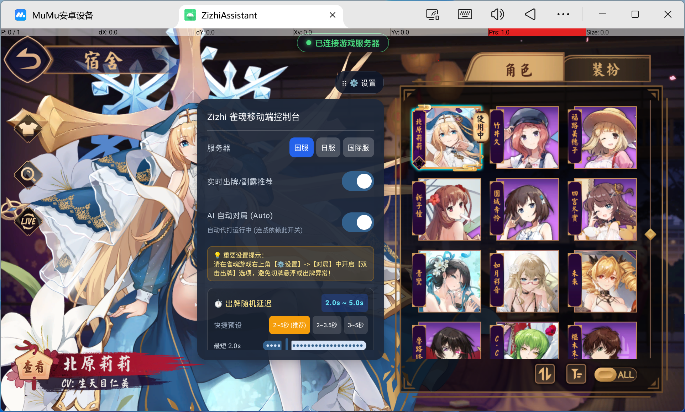
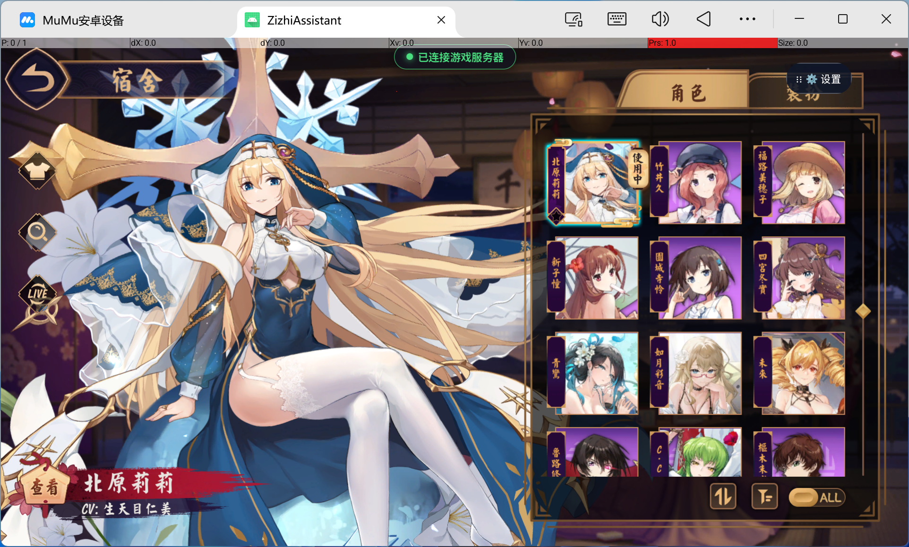
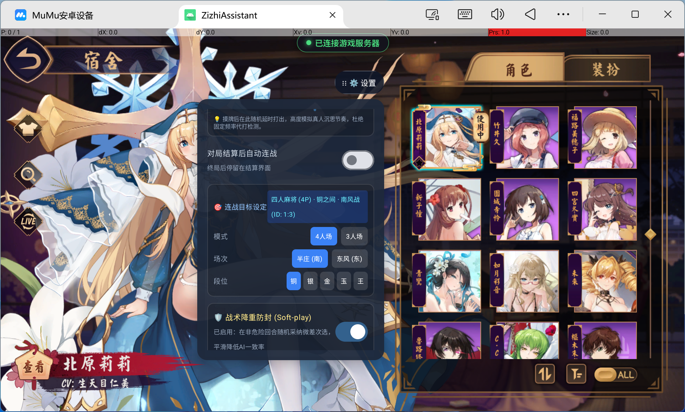
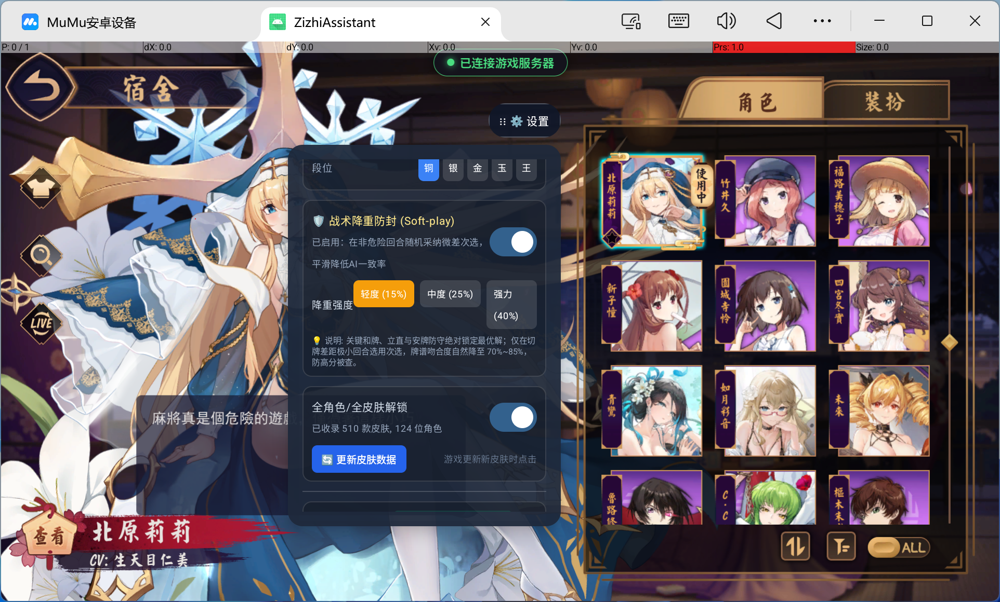
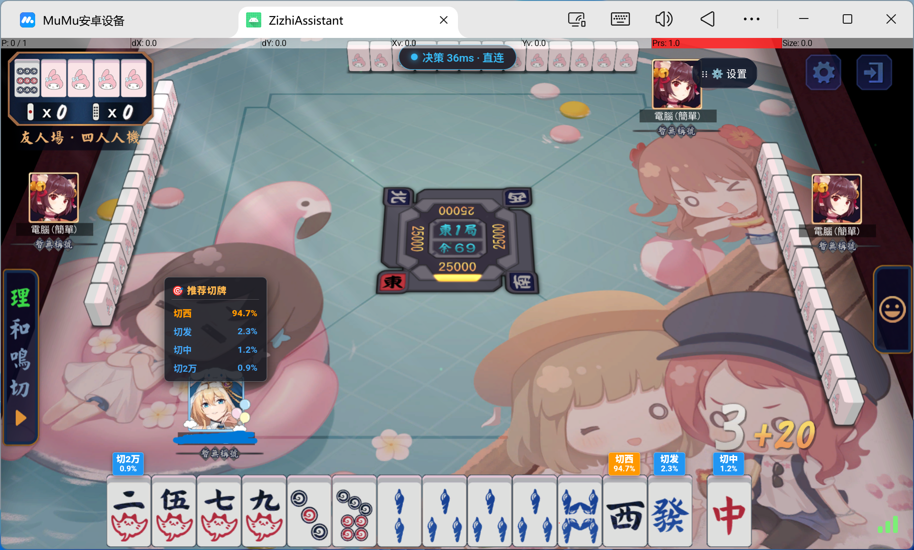

# 🀄 雀魂智囊助手（Zizhi MahjongSoul Assistant）- 安卓版

<p align="center">
  
  
  
  
  
</p>

<p align="center">
  <b>安卓端雀魂 AI 决策辅助 · 本地 ResNet 编码 + 服务端决策头 · 全自动对局</b>
  <br>
  <i>In-App WebView Hook | Real-time HUD | Auto-Play & Rematch | Skin Unlock | Native Anti-Tamper</i>
</p>

---

## 📸 界面展示

### 1. 实战对局 HUD 悬浮推荐

> 在游戏画面内直接叠加推荐切牌与各候选胜率，顶部实时显示 `决策 36ms · 直连` 延迟状态。

<p align="center">
  
</p>

---

### 2. 移动端控制台（主设置）

> 服务器选择（国服/日服/国际服）、实时推荐开关、AI 自动对局开关、出牌随机延迟（2.0s~5.0s 拟人化）。

<p align="center">
  
</p>

---

### 3. 战术降重防封（Soft-play）

> 在非危险回合随机采纳微差次选，平滑降低 AI 一致性。支持轻度(15%) / 中度(25%) / 强力(40%) 三档强度。
> 关键和牌、立直与安牌防守**绝对锁定最优解**。

<p align="center">
  
</p>

---

### 4. 自动连战与目标设定

> 对局结算后自动连战，支持自定义模式（4人/3人）、场次（半庄/东风）、段位（铜/银/金/玉/王）。

<p align="center">
  
</p>

---

### 5. 延迟与线路监控

> HUD 顶部状态胶囊实时显示推理延迟与线路：`决策 36ms · 直连` 表示直连源站，
> 若显示 `· CF` 说明回落到了 Cloudflare 中转（延迟约 250ms+）。

<p align="center">
  
</p>

---

## 🎯 核心功能特性

| 功能模块 | 说明 |
| :--- | :--- |
| 🧠 **Mortal 深度学习决策** | 本地运行 ResNet 编码器生成 1024 维特征，服务端决策头输出 46/44 维动作 Q 值，端云协同保证精度与资产安全。 |
| ⚡ **~25ms 低延迟推理** | 推理通道直连源站（跳过 CDN 中转），单次往返约 25ms，20 秒思考时间内从容决策。 |
| 🖥️ **游戏内 HUD 悬浮** | WebView 注入方式直接叠加到游戏画面，零悬浮窗权限，显示推荐切牌与各候选胜率。 |
| 🤖 **全自动对局 (Auto)** | 自动切牌、自动和牌、自动立直、自动鸣牌、自动跳过，支持拟人化随机延迟 2.0s~5.0s。 |
| 🔁 **自动连战** | 终局结算后自动排队下一局，支持 4人/3人、半庄/东风、铜银金玉王段位目标设定。 |
| 🎯 **战术降重防封** | 非关键局面按概率选次优解，压低 AI 吻合度指纹；关键决策锁定最优解保胜率。 |
| 👗 **全角色/皮肤解锁** | 本地视觉解锁，510 款皮肤 & 124 位角色，支持一键更新皮肤数据库。 |
| 🛡️ **native 层三重校验** | 签名指纹 / 模型哈希 / 环境扫描全部下沉到 `.so`，DEX 内无可改常量。 |
| 🔐 **端云授权体系** | 卡密激活 + Ed25519 签名票据（30 分钟时效）+ HMAC 请求签名 + 防重放。 |
| 📦 **模型内存加载** | 模型解密后直接在内存构建 ONNX Session，不落盘，root 设备也无法直接提取。 |

---

## 🚀 快速开始

### 第一步：下载安装

前往本仓库右侧的 [**Releases**](https://github.com/Sleep312/ZizhiAssistant-Android/releases) 页面，
下载最新的 `ZizhiAssistant_Android_v*.apk`。

> **系统要求**：Android 8.0 (API 26) 及以上，arm64-v8a 架构

### 第二步：允许安装

在手机设置中允许「安装未知来源应用」，然后安装 APK。

### 第三步：输入卡密激活

1. 首次启动会弹出授权窗口
2. 粘贴你的**商业授权卡密**
3. 点击【立即激活绑定】（一机一码自动绑定硬件）

### 第四步：开始对局

1. 点击【进入主程序（开始对局）】
2. 在控制台选择服务器（国服/日服/国际服）
3. 打开【实时出牌/副露推荐】和【AI 自动对局】
4. 进入游戏对局，HUD 会自动显示推荐

> 💡 **重要提示**：请在雀魂游戏右上角【⚙️ 设置】→【对局】中开启【双击出牌】选项，
> 避免切牌悬浮或出牌异常。

---

## ⚙️ 参数说明

| 参数 | 说明 |
| :--- | :--- |
| **出牌随机延迟** | 模拟人类思考时间，推荐 2.0s~5.0s。可快捷选择 2~5秒 / 2~3.5秒 / 3~5秒。 |
| **战术降重强度** | 轻度 15% / 中度 25% / 强力 40%。越高越拟人，但会略微牺牲胜率。 |
| **降重豁免** | 和牌、立直、危险铳牌防守时始终使用最优解，不受降重影响。 |
| **自动连战** | 依赖【AI 自动对局】总开关，关闭代打时同步停止连战排队。 |

---

## 🔧 技术架构

```
┌─────────────────────────────────────────────────────────────┐
│  Android App (WebView + Compose)                            │
│  ├─ 游戏页面注入 (zizhi_hook.js)                             │
│  │   └─ 拦截 WebSocket → 解析 Liqi protobuf → 提取牌局状态    │
│  ├─ 本地 ResNet 编码器 (ONNX Runtime, 内存加载)              │
│  │   └─ obs[1,1012,34] → phi[1,1024]                        │
│  └─ 推理请求 (直连 ~25ms)                                     │
└──────────────────────────┬──────────────────────────────────┘
                           │ ticket + phi + mask + HMAC
                           ▼
┌─────────────────────────────────────────────────────────────┐
│  授权服务器 (FastAPI)                                         │
│  ├─ 卡密校验 / Ed25519 票据签发 (30min TTL)                  │
│  ├─ 决策头推理: q = phi @ W.T + b (46/44 维)                │
│  └─ 风控: phi 体检 / 限流配额 / 多 IP 标记                    │
└─────────────────────────────────────────────────────────────┘
```

**设计要点**：
- **编码器在本地**：保证低延迟，避免上传 34KB obs
- **决策头在服务端**：核心资产不外流，无有效票据无法获得 Q 值
- **模型内存加载**：解密后直接构建 ONNX Session，不落盘

---

## 🛡️ 安全机制

| 层级 | 措施 |
| :--- | :--- |
| **APK 层** | R8 全量混淆（dex 33MB → 4.3MB）、非 debuggable、签名自检 |
| **Native 层** | 签名指纹 / 模型哈希 / Frida·Xposed 扫描全部编译进 `.so`，状态位互锁 |
| **数据层** | 模型 AES-256-CTR 加密 + 内存解密 + SHA-256 校验，不落盘 |
| **传输层** | 授权接口强制 HTTPS；推理接口 HMAC 签名 + 时间窗 + nonce 防重放 |
| **服务端** | 票据短时效（30min）、phi 结构体检、限流配额、多 IP 风控 |

---

## 📋 更新日志

### v1.0.2 (2025-10-22)

- 🐛 修复：手牌同时有红五宝牌与普通五时，误将红宝牌打出的问题
- 🐛 修复：碰/杠判定错位（推荐碰却执行杠）
- ⚡ 优化：决策推理延迟从 ~270ms 降至 **~25ms**（直连加速）
- ⚡ 优化：减少无效推理请求，一巡只算一次（5次 → 1次）
- 📊 新增：HUD 实时显示决策延迟与线路
- 📊 新增：登录页显示真实服务器延迟

---

## ❓ 常见问题

<details>
<summary><b>Q: 提示「运行环境异常」无法使用？</b></summary>

说明检测到重打包、调试器、Frida 或 Xposed 等异常环境。
请从官方渠道下载正版 APK，卸载后重新安装。
</details>

<details>
<summary><b>Q: HUD 显示「决策 268ms · CF」是什么意思？</b></summary>

表示推理请求回落到了 Cloudflare 中转，延迟较高。
正常情况下应显示「直连」（约 25ms）。如果持续显示 CF，请检查网络环境。
</details>

<details>
<summary><b>Q: 出牌切错 / 悬浮怎么办？</b></summary>

请在雀魂游戏内【⚙️ 设置】→【对局】中开启【双击出牌】选项。
</details>

<details>
<summary><b>Q: 卡密可以在几台设备使用？</b></summary>

一机一码，自动绑定硬件指纹。更换设备需联系客服解绑。
</details>

---

## ⚠️ 免责声明

本项目仅供个人学习与研究使用。

使用者应自行承担使用本工具产生的全部风险与责任，包括但不限于游戏账号处罚、封禁等后果。
作者不对任何直接或间接损失承担责任。请勿将本工具用于商业用途。

---

<p align="center">
  <sub>Powered by Mortal AI Engine · Built with Kotlin & ONNX Runtime</sub>
</p>
